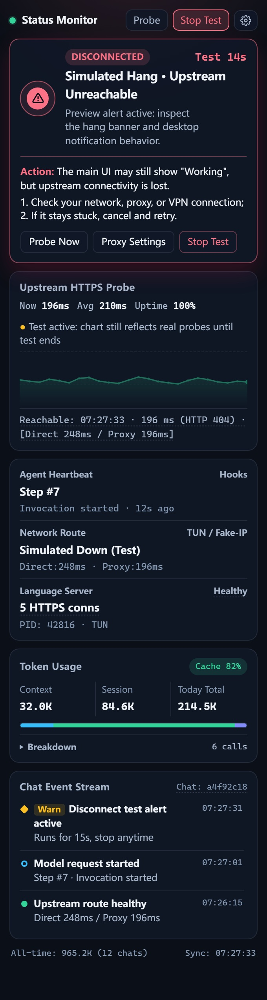
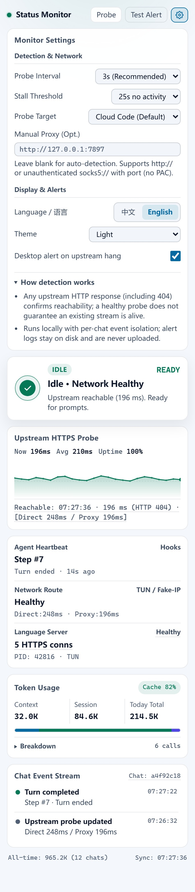

[简体中文](README.md) | **English**

# Antigravity Status Monitor (`antigravity-status-monitor`)

During long Antigravity runs, the main UI can stay stuck on a spinning **"Working"** indicator with no output — sometimes the model or local tools are genuinely busy, and other times a dropped VPN, TUN route glitch, or broken proxy has silently stalled the request.

**Antigravity Status Monitor** is a **local-only, zero-dependency** side-pane dashboard that unifies live agent phases, host `Language Server` health, direct/proxy HTTPS reachability probes, and token usage. At a glance, you can tell active progress apart from a silent hang — with desktop alerts and inline recovery actions when connectivity drops.

- **Clear status at a glance**: Separates thinking, tool execution, pending background tasks, API retries, and upstream hangs so you neither wait blindly nor cancel healthy work.
- **Built for narrow side panes**: Adapts cleanly from narrow auxiliary panes to dual-column desktop views, with host-matched Dark/Light themes, EN/ZH localization, 15s alert drills, and in-page hover tooltips.
- **Private and local by design**: Binds strictly to `127.0.0.1` with token-authenticated APIs and strict offline CSP; probes send lightweight reachability checks with zero account credentials or telemetry.

---

## UI Preview

| Live Working State & Tooltip | Disconnect Drill & Inline Actions | Light Settings & Detection Guide |
| :---: | :---: | :---: |
|  |  |  |

> Click any screenshot to inspect full resolution: dark working state with in-page hover tooltip (left), 15s disconnect alert drill with inline actions (center), and light-theme settings with expanded "How detection works" disclosure (right).

---

## How It Works

Because a single spinner hides where execution paused, the panel tracks four direct signals:

1. **Lifecycle Hooks + Transcript Phase Inference, Background Tasks & API Retry Detection**
   - [hooks.json](hooks.json) registers only `PreInvocation` and `Stop` (using Antigravity's bundled `agy-node` first, falling back to `node`).
   - **Pending Background Task State (`BACKGROUND_TASK`)**: When a turn finishes while background commands or subagents are still running, parses `Stop` Hook `fullyIdle: false` (alongside a `transcript.jsonl` unfinished background-task fallback) to show **Background Task · Waiting for Wakeup** instead of falsely dropping to `IDLE` or triggering false `25s` stall alerts, and resumes seamlessly when Antigravity wakes back up.
   - **Parallel Tool Progress & Aborted Status Guard**: Keeps `RUNNING TOOL` while a multi-tool `PLANNER_RESPONSE` has only partially written back its results, and returns immediately to `IDLE` when an aborted `PLANNER_RESPONSE` (`CANCELLED`/`ERROR`) still carries `tool_calls`.
   - Resets silence timers immediately on new Hooks or `transcript.jsonl` writes, and parses `ERROR_MESSAGE` retries (`wsasend` upload resets, `EOF`, `stream idle timeout`, `model unreachable`, with a 3-minute expiry window) plus intermediate steps to surface `API RETRY` directly.
2. **Dual-Link Upstream HTTPS Probes, Tiered Debounce & Isolated Polling**
   - Periodically opens short-lived HTTPS `GET` probes (defaulting to `https://daily-cloudcode-pa.googleapis.com`, `4000ms` timeout) across direct/TUN and proxy routes (env vars, OS settings, or manual HTTP `Basic` / unauthenticated SOCKS5 proxy), combined with host `Language Server` 443 socket state.
   - **Tiered Debounce, Mixed-Route Correction & Sleep Guard**: Hard errors (`ENOTFOUND`, `ECONNREFUSED`, blocked HTTP statuses) trigger `DISCONNECTED_HANG` after 2 consecutive failures, while pure timeouts enter `NET_SUSPECT` on failure #2 and confirm on failure #3; active `proxyConns` with a healthy proxy and failing direct path prefer `proxy` (preventing carrier-grade NAT `100.64.0.0/10` or stray direct sockets from causing false offline alerts); sleep/wake clock jumps reset stale failure streaks cleanly.
   - **Adaptive Short Polling & Strict Current-Chat Isolation**: Visible panels poll `/api/status` every 1s with short-lived requests and pause immediately when hidden (`visibilityState === "hidden"`), preventing Chromium's 6-connection-per-origin HTTP/1.1 limit from stalling new Sidecar tabs or action buttons. The UI provides no switcher control, and the backend removes `auto` switching and cross-directory conversation hijacking altogether—every conversation keeps a physically bucketed live event stream and only displays its own Hooks, tool steps, simulation alerts, and network changes, updating only when the host switches chats. `/api/events` SSE remains available on the backend for external consumers.
3. **Host Process Tracking, Debounced Alerts & Clean Auto-Exit**
   - Tracks the matching host `Language Server` via `ANTIGRAVITY_LS_ADDRESS`. Process exit triggers `LS_DOWN` immediately, while in-process `/healthz` timeouts (`3000ms`) and isolated `SYN_SENT` sockets (when healthy `established443` sockets remain) debounce across 2 consecutive inspections; if `/healthz` fails 3 checks in a row, the Sidecar exits cleanly instead of leaving orphans.
   - **Multi-Chat Alert Evaluation & Bounded History**: Evaluates pinned/active chats cleanly without losing background-chat hang alerts, distinguishes **Upstream Connection Lost** from **Language Server Unreachable** desktop notifications, and persists `convId` and `message` fields to `.runtime/alerts.log` (bounded JSONL with automatic trimming).
4. **Default Auth on All APIs + DNS Rebinding Guard + Strict CSP**
   - Binds strictly to `127.0.0.1` and validates the HTTP `Host` header against loopback addresses (`127.0.0.1`, `localhost`, `[::1]`) on every request to block DNS rebinding attacks;
   - **Enforces authentication on all `GET /api/*` and `POST /api/*` routes by default**: even standalone launches without `ANTIGRAVITY_SIDECAR_UI_TOKEN` automatically generate a random 48-char hex `uiToken` (printed cleanly in the startup `?token=...` URL). Rejects `Sec-Fetch-Site: cross-site`, `Origin: null`, and untrusted origins, enforces `Content-Type: application/json` on `POST`, and separates UI tokens from the Hook token (`.runtime/server.json` never stores `uiToken`);
   - **Strict Browser-Level CSP**: serves `Content-Security-Policy: default-src 'self'; connect-src 'self'` across dashboard assets and APIs (with zero inline styles or scripts), physically locking down outbound network requests from the WebView.

---

## Scope & Limitations

This is a lightweight Sidecar status monitor rather than a packet-level inspector, with a few practical boundaries:

* **Fresh short probes passing doesn't guarantee an old stream is alive**: Probes open new short-lived HTTPS connections to check DNS/TLS/HTTP reachability (`2xx/3xx` and `400/404/405/410` count as reachable since `daily-cloudcode-pa.googleapis.com` returns `404` on `/`; `401/403/407/408/429/451` and `5xx` count as blocked or failed). When Antigravity logs an `ERROR_MESSAGE` retry entry (e.g., an aborted large upload via `wsasend` or stream reset), the panel surfaces `API RETRY` immediately; if an open request hangs silently before any error log is written while fresh probes pass, the panel will lean toward **Possible Model Stall**.
* **What proxy & TUN detection covers**: Automatically reads **HTTP proxies** (including `Basic` auth) and **unauthenticated SOCKS5 proxies** from environment variables (`HTTPS_PROXY` / `HTTP_PROXY` / `ALL_PROXY` / `NO_PROXY`), Windows registry `HKCU`/`HKLM` (with `ProxyOverride` and `DefaultConnectionSettings`), macOS `scutil` (with `ExceptionsList`), and Linux GNOME `gsettings` (with `ignore-hosts`), plus a **Manual Proxy** box in Settings when you need an override (for PAC, non-GNOME Linux, standalone SOCKS5, etc.). **It does not evaluate PAC scripts (warns instead), `https://` or `socks4://` proxies, password-authenticated SOCKS5, enterprise NTLM auth, or process-injected transparent proxies; corporate MITM root certs not trusted by Node can also report TLS failures.** TUN interfaces are heuristically tagged using `198.18.0.0/15` (Fake-IP) and `100.64.0.0/10` (CGNAT / Tailscale / WireGuard); when active proxy connections exist and the proxy probe succeeds while direct fails, mixed-route fallback still trusts the working proxy (preventing ISP CGNAT `100.64.0.0/10` addresses from causing false alerts).
* **Timeouts & high-reasoning models**: Default single probe timeout is `4000ms` (pure timeouts debounce for `3` checks before raising `DISCONNECTED_HANG`, whereas hard network errors trigger at `2`). Because Antigravity flushes `PLANNER_RESPONSE` after finishing a full generation, deep-reasoning runs (`> 25s`) may briefly show `STALLED` unless you raise the stall threshold to `45s` in Settings.
* **Small runtime footprint**: Antigravity spawns a short-lived Node/agy-node hook process on `PreInvocation` and `Stop`, while the Sidecar stays resident alongside the host.
* **Authenticated local API routes**: All `GET /api/*` (`/api/status`, `/api/events`) and `POST /api/*` routes require `X-Sidecar-Token` (or `?token=` for `EventSource`) by default alongside loopback `Host`, `Sec-Fetch-Site`, and `Origin` checks. Unauthenticated or cross-site local probes are rejected with `401`/`403`.
* **Token math**: `total` simply adds raw `input_tokens + cache_read_tokens + output_tokens` occurrences across turns. Treat it as a rough sense of session workload and cache hit ratio rather than exact billing or quota usage. Live session stats follow the Hook-reported path; all-time stats scan `transcript.jsonl` (falling back to `transcript_full.jsonl`).
* **Local alert log & notification suppression**: The Sidecar keeps only a bounded JSONL summary of alert/recovery transitions in `.runtime/alerts.log` (default `64 KB` / latest `120` lines) with zero external telemetry. Setting `ANTIGRAVITY_APP_DATA_DIR` strictly scopes `brain/` discovery, and automated/headless runs can set `ASM_DISABLE_NOTIFICATIONS=1` to suppress OS toast popups.

---

## Cross-Platform Support Matrix

| Platform | HTTPS Probes | System Proxy Detection | Language Server & 443 Sockets | Desktop Notifications | Verification Level |
| :--- | :--- | :--- | :--- | :--- | :--- |
| **Windows** | Supported | Env vars + Registry `HKCU`/`HKLM` (`HTTP` / `SOCKS5` / `ProxyOverride`; PAC warning + manual proxy fallback) | `netstat -ano -p TCP` + `tasklist` + CIM | PowerShell WinRT Toast notifications | **Long-run live desktop verified** + CI integration tests |
| **macOS** | Supported | Env vars + `scutil --proxy` (`HTTP` / `SOCKS5`; PAC warning + manual proxy fallback) | `lsof -nP -iTCP` + `pgrep`/`ps` | `osascript` notifications | Unit tests + GitHub Actions macOS CI |
| **Linux** | Supported | Env vars (`ALL_PROXY`/`NO_PROXY`) + GNOME `gsettings` (or env/manual proxy on non-GNOME) | `ss -tnap` (fallback `lsof`) + `pgrep`/`ps` | `notify-send` | Unit tests + GitHub Actions Ubuntu CI |

---

## Quick Install & Uninstall

### Option 1: Ask Antigravity to Download & Install Automatically (Recommended, No Git / CLI Needed)

Not familiar with Git or terminal commands? Open a new Antigravity chat, paste the prompt below, and Antigravity will download, verify, extract, and install the plugin for you while preserving any existing `.runtime/config.json`:

```text
Please download and install (or update) the Antigravity Status Monitor plugin for me:
1. Download the package matching my OS from https://github.com/rimenine/antigravity-status-monitor/releases/latest (agent-status-monitor.zip on Windows, agent-status-monitor.tar.gz on macOS / Linux), verify its checksum against SHA256SUMS.txt if present, or fall back to downloading the main branch source archive if no prebuilt Release is available.
2. Extract it to a temporary directory and run install.ps1 (Windows) or install.sh (macOS / Linux), keeping my existing .runtime/config.json intact.
3. Clean up the temporary files afterward and verify the plugin files and side pane entrypoint are ready.
```

> Works for upgrades too: send the same prompt again and Antigravity will stop the old Sidecar cleanly, update runtime files, and preserve your threshold and notification settings.

### Option 2: GitHub Releases Archive or One-Line Command

Download a prebuilt `.zip` or `.tar.gz` bundle (with `SHA256SUMS.txt`) from [Releases](https://github.com/rimenine/antigravity-status-monitor/releases/latest) — extract `agent-status-monitor/` directly into `~/.gemini/config/plugins/`, run the included `install.ps1` / `install.sh`, or install in one command:

```powershell
# Windows (PowerShell one-liner)
$tmp = Join-Path $env:TEMP "asm-install"; Remove-Item $tmp -Recurse -Force -ErrorAction SilentlyContinue; New-Item -ItemType Directory -Force $tmp | Out-Null
Invoke-WebRequest "https://github.com/rimenine/antigravity-status-monitor/releases/latest/download/agent-status-monitor.zip" -OutFile "$tmp\asm.zip"
Expand-Archive "$tmp\asm.zip" -DestinationPath $tmp -Force
powershell -ExecutionPolicy Bypass -File "$tmp\agent-status-monitor\install.ps1"
```

```bash
# macOS / Linux (one-liner)
TMP_DIR="$(mktemp -d)" && curl -fsSL "https://github.com/rimenine/antigravity-status-monitor/releases/latest/download/agent-status-monitor.tar.gz" | tar -xz -C "$TMP_DIR" && sh "$TMP_DIR/agent-status-monitor/install.sh" && rm -rf "$TMP_DIR"
```

### Option 3: Git Clone Installer & Uninstall

```powershell
# Windows (PowerShell)
git clone https://github.com/rimenine/antigravity-status-monitor.git
cd antigravity-status-monitor
powershell -ExecutionPolicy Bypass -File .\install.ps1
```

```bash
# macOS / Linux
git clone https://github.com/rimenine/antigravity-status-monitor.git
cd antigravity-status-monitor
sh ./install.sh
```

You can also clone directly into `~/.gemini/config/plugins/agent-status-monitor`. The `install.ps1` / `install.sh` script auto-detects `~/.gemini/config` and `agy-node` / `node`, copies only the files needed at runtime (skipping `tests/`, `docs/`, `.github/`, `.git/`, `scripts/`, and `README.en.md`), and keeps any existing `.runtime/config.json` intact.

Uninstall (the uninstaller removes `sidecar.json` and stops the running Sidecar cleanly; if Antigravity is currently open, disabling the plugin or closing the IDE first avoids host auto-restart attempts during cleanup; you can also ask Antigravity to run `uninstall.ps1` / `uninstall.sh` inside the plugin directory):

```powershell
# Windows (PowerShell)
powershell -ExecutionPolicy Bypass -File .\uninstall.ps1              # Full removal
powershell -ExecutionPolicy Bypass -File .\uninstall.ps1 -KeepConfig  # Remove plugin, keep config.json
```

```bash
# macOS / Linux
sh ./uninstall.sh                # Full removal
sh ./uninstall.sh --keep-config  # Remove plugin, keep config.json
```

After installation, open or restart Antigravity (or toggle the plugin off and back on after upgrading), and ask in chat to **`Open the Antigravity Status Monitor panel`** (or **`打开反重力状态监控面板`**) to bring up the side pane.

---

## Controls & Configuration

- **Top bar actions**: `Probe` (run immediate connectivity test), `Test Alert` / `Stop Test` (15-second simulated hang drill), and **Settings gear icon** (toggles settings below the header; press `Esc` to close and restore focus).
- **Inline recovery & hover tooltips**: Disconnect alerts include **Probe Now**, **Proxy Settings**, and **Stop Test** buttons; dotted-underlined indicators (`HTTP 404` reachability, `Healthy`, HTTPS connections, sparkline samples, and short chat IDs) display crisp in-page hover tooltips.
- **Configurable options**: Language (`中文` / `English`, auto-detected from system locale on first run), probe interval (`2s` / `3s` / `5s`), stall threshold (`15s` / `25s` / `45s`), probe target, manual proxy override, theme (`Follow Host / System`, `Dark`, `Light`), desktop hang notification toggle, and a collapsible `How detection works` disclosure.
- **Token breakdown**: Shows live Context, Session, Today Total, cache ratio, and breakdown bar by default; expand **Breakdown** for raw input, cache read, and output totals plus counting notes.

---

## Project Structure

```text
antigravity-status-monitor/
├── package.json                    # Package metadata and test runner (npm test)
├── plugin.json                     # Antigravity plugin manifest
├── .github/workflows/
│   ├── ci.yml                      # GitHub Actions matrix CI (Ubuntu / macOS / Windows)
│   └── release.yml                 # Tag / manual GitHub Release packager workflow
├── scripts/
│   └── package-release.mjs         # Zero-dependency .zip / .tar.gz & SHA256SUMS bundler
├── hooks.json                      # Lifecycle Hooks (PreInvocation + Stop)
├── install.ps1 / uninstall.ps1     # Windows auto-detect installer / uninstaller
├── install.sh / uninstall.sh       # macOS / Linux auto-detect installer / uninstaller
├── LICENSE                         # MIT License
├── README.md                       # Simplified Chinese README
├── README.en.md                    # English README
├── assets/logo.svg                 # Plugin icon
├── docs/screenshots/               # README preview screenshots (CN & EN)
├── hooks/hook-reporter.mjs         # Hook reporter script (X-Hook-Token auth)
├── skills/status-monitor/SKILL.md  # Side-pane launch & diagnostics skill
├── tests/                          # Unit and real-process integration tests (node:test)
└── sidecars/status-monitor/
    ├── sidecar.json                # Sidecar registration manifest
    ├── server.mjs                  # Sidecar entrypoint, HTTP routing & lifecycle wiring
    ├── lib/
    │   ├── config.mjs              # Runtime paths, brain isolation & config persistence
    │   ├── alert-logger.mjs        # Bounded JSONL alert & recovery persistence log
    │   ├── runtime-paths.mjs       # Multi-window .runtime/servers & hooks scope helpers
    │   ├── http-helpers.mjs        # Security headers, static asset whitelist & JSON I/O
    │   ├── sse-hub.mjs             # SSE broadcast hub & pinned conversation tracking
    │   ├── server-registry.mjs     # Multi-instance registration & exit cleanup
    │   ├── probe-coordinator.mjs   # Probe scheduler, LS inspection, alert dedup & logging
    │   ├── i18n.mjs                # Chinese/English localization strings, alerts & verdicts
    │   ├── security.mjs            # CSRF, Origin, Content-Type & dual-token verification
    │   ├── sdk-bridge.mjs          # sidecar_sdk bridge (/preload.js & AgentAPI)
    │   ├── transcript-phase.mjs    # Pure transcript phase, parallel tool, task & error helpers
    │   ├── transcript-reader.mjs   # Transcript tail-chunk reader & snapshot builder
    │   ├── fallback-hooks.mjs      # Scoped offline fallback hook loader & cleanup
    │   ├── timeline-store.mjs      # Physically bucketed per-chat live event store
    │   ├── state-store.mjs         # Strict current-chat state & snapshot builder
    │   ├── verdict.mjs             # Pure state diagnosis engine
    │   ├── proxy-bypass.mjs        # NO_PROXY / CIDR / wildcard bypass matching & IP helpers
    │   ├── proxy-url.mjs           # Proxy URL validation/parsing & env proxy reader
    │   ├── proxy-system.mjs        # Windows Registry / macOS scutil / Linux gsettings parsers
    │   ├── proxy.mjs               # Cached proxy detection orchestrator & facade
    │   ├── proxy-tunnel.mjs        # HTTP CONNECT & unauthenticated SOCKS5 tunnel handshakes
    │   ├── process-probe.mjs       # Language Server PID, 443 socket & route inspection
    │   ├── notify.mjs              # Cross-platform desktop alerts (WinRT / AppleScript / libnotify)
    │   ├── probe.mjs               # Direct & proxied HTTPS upstream probe facade
    │   └── tokens.mjs              # Token usage parser and incremental cache
    └── public/
        ├── index.html
        ├── styles.css
        ├── app.js                  # Dashboard bootstrap, focus handling & hover tooltips
        └── js/
            ├── i18n.js             # Frontend zh/en dictionaries & static i18n
            ├── format.js           # Duration/token formatters & adaptive theme resolver
            ├── render.js           # Sparkline SVG, timeline & telemetry card renderers
            └── client.js           # Auth transport, adaptive polling & error banner
```

---

## Running Automated Tests

Zero external dependencies — run with system Node or Antigravity's bundled `agy-node`:

```bash
npm test
# Or using Antigravity's built-in runtime:
agy-node --test tests/*.test.mjs
```

---

## License

[MIT](LICENSE) © 2026 [rimenine](https://github.com/rimenine)
