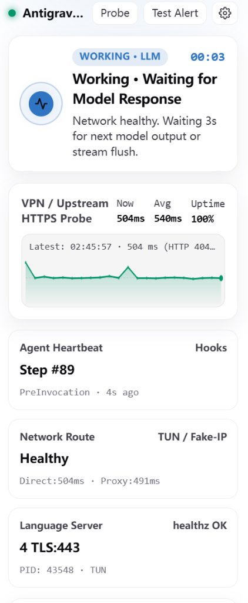

[简体中文](README.md) | **English**

# Antigravity Status Monitor (`antigravity-status-monitor`)

When running long agent tasks in Antigravity, the main UI can stay stuck on a spinning **"Working"** state with no visible output — either because the model or local tools are still running, or because the request silently hung underneath due to a stalled stream or dropped connection.

Built with **zero external dependencies**, this Sidecar sits in Antigravity's auxiliary pane and brings together Lifecycle Hooks, `transcript.jsonl` writes, the local `Language Server` socket, upstream HTTPS probes, and token counts so you can quickly tell real progress apart from a silent hang ("false working" state).

---

## UI Preview

| Live Working State & Probe Chart | Hang Alert & Toast Preview | Settings & Live Event Stream |
| :---: | :---: | :---: |
|  |  |  |

---

## How It Works

Because a single spinner hides where execution paused, the panel tracks four direct signals:

1. **Lifecycle Hooks + Transcript Activity Timer**
   - [hooks.json](hooks.json) registers only `PreInvocation` and `Stop` (using Antigravity's bundled `agy-node` first, falling back to `node`).
   - Whenever new output lands in `transcript.jsonl` or a Hook fires, the silence timer resets immediately so long multi-tool turns aren't flagged as stuck.
2. **Silent Hang Detection & Host Health**
   - Combines how long the session has stayed silent against your stall threshold with host `Language Server` `/healthz` checks (located via `ANTIGRAVITY_LS_ADDRESS`), stuck `TCP 443 SYN_SENT` sockets, and upstream probe results. If Antigravity closes, the Sidecar exits cleanly on its own instead of sticking around as an orphan process.
3. **Dual-Link Upstream HTTPS Probes & SSE Stream**
   - Periodically opens fresh short-lived HTTPS `GET` probes (defaulting to `https://daily-cloudcode-pa.googleapis.com`) across direct/TUN and proxy routes (reading env vars / OS proxy settings, plus an optional manual proxy with HTTP `Basic` auth or unauthenticated SOCKS5).
   - **SSE + Polling Fallback**: Pushes updates over `/api/events` and quietly falls back to `/api/status` polling if the stream drops.
4. **Default Auth on All APIs + DNS Rebinding Guard + Strict CSP**
   - Binds strictly to `127.0.0.1` and validates the HTTP `Host` header against loopback addresses (`127.0.0.1`, `localhost`, `[::1]`) on every request to block DNS rebinding attacks;
   - **Enforces authentication on all `GET /api/*` and `POST /api/*` routes by default**: even standalone launches without `ANTIGRAVITY_SIDECAR_UI_TOKEN` automatically generate a random 48-char hex `uiToken` (printed cleanly in the startup `?token=...` URL). Rejects `Sec-Fetch-Site: cross-site`, `Origin: null`, and untrusted origins, enforces `Content-Type: application/json` on `POST`, and separates UI tokens from the Hook token (`.runtime/server.json` never stores `uiToken`);
   - **Strict Browser-Level CSP**: serves `Content-Security-Policy: default-src 'self'; connect-src 'self'` across dashboard assets and APIs (with zero inline styles or scripts), physically locking down outbound network requests from the WebView.

---

## Scope & Limitations

This is a lightweight Sidecar status monitor rather than a packet-level inspector, with a few practical boundaries:

* **Fresh short probes passing doesn't guarantee an old stream is alive**: Probes open new short-lived HTTPS connections to check DNS/TLS/HTTP reachability (`2xx/3xx` and `400/404/405/410` count as reachable since `daily-cloudcode-pa.googleapis.com` returns `404` on `/`; `401/403/407/408/429/451` and `5xx` count as blocked or failed). If an already-open streaming connection goes half-dead upstream while a brand-new probe succeeds or fails over, the panel will lean toward **Possible Model Stall** rather than offline hang.
* **What proxy & TUN detection covers**: Automatically reads **HTTP proxies** (including `Basic` auth) and **unauthenticated SOCKS5 proxies** from environment variables (`HTTPS_PROXY` / `HTTP_PROXY` / `ALL_PROXY` / `NO_PROXY`), Windows registry `HKCU`/`HKLM` (with `ProxyOverride` and `DefaultConnectionSettings`), macOS `scutil` (with `ExceptionsList`), and Linux GNOME `gsettings` (with `ignore-hosts`), plus a **Manual Proxy** box in Settings when you need an override (for PAC, non-GNOME Linux, standalone SOCKS5, etc.). **It does not evaluate PAC scripts (warns instead), `https://` or `socks4://` proxies, password-authenticated SOCKS5, enterprise NTLM auth, or process-injected transparent proxies; corporate MITM root certs not trusted by Node can also report TLS failures.** TUN interfaces are heuristically tagged using `198.18.0.0/15` (Fake-IP) and `100.64.0.0/10` (CGNAT / Tailscale / WireGuard).
* **Small runtime footprint**: Antigravity spawns a short-lived Node/agy-node hook process on `PreInvocation` and `Stop`, while the Sidecar stays resident alongside the host.
* **Authenticated local API routes**: All `GET /api/*` (`/api/status`, `/api/events`) and `POST /api/*` routes require `X-Sidecar-Token` (or `?token=` for `EventSource`) by default alongside loopback `Host`, `Sec-Fetch-Site`, and `Origin` checks. Unauthenticated or cross-site local probes are rejected with `401`/`403`.
* **Token math**: `total` simply adds raw `input_tokens + cache_read_tokens + output_tokens` occurrences across turns. Treat it as a rough sense of session workload and cache hit ratio rather than exact billing or quota usage. Live session stats follow the Hook-reported path; all-time stats scan `transcript.jsonl` (falling back to `transcript_full.jsonl`).

---

## Cross-Platform Support Matrix

| Platform | HTTPS Probes | System Proxy Detection | Language Server & 443 Sockets | Desktop Notifications | Verification Level |
| :--- | :--- | :--- | :--- | :--- | :--- |
| **Windows** | Supported | Env vars + Registry `HKCU`/`HKLM` (`HTTP` / `SOCKS5` / `ProxyOverride`; PAC warning + manual proxy fallback) | `netstat -ano -p TCP` + `tasklist` + CIM | PowerShell WinRT Toast notifications | **Long-run live desktop verified** + CI integration tests |
| **macOS** | Supported | Env vars + `scutil --proxy` (`HTTP` / `SOCKS5`; PAC warning + manual proxy fallback) | `lsof -nP -iTCP` + `pgrep`/`ps` | `osascript` notifications | Unit tests + GitHub Actions macOS CI |
| **Linux** | Supported | Env vars (`ALL_PROXY`/`NO_PROXY`) + GNOME `gsettings` (or env/manual proxy on non-GNOME) | `ss -tnap` (fallback `lsof`) + `pgrep`/`ps` | `notify-send` | Unit tests + GitHub Actions Ubuntu CI |

---

## Quick Install & Uninstall

### Option 1: GitHub Releases One-Click Packaged Bundles (Recommended)

Download a prebuilt `.zip` or `.tar.gz` bundle (with `SHA256SUMS.txt`) from [Releases](https://github.com/rimenine/antigravity-status-monitor/releases/latest) — either extract `agent-status-monitor/` directly into your plugins folder, run the included `install.ps1` / `install.sh`, or install in one command:

```powershell
# Windows (PowerShell one-liner)
$tmp = Join-Path $env:TEMP "asm-install"; Remove-Item $tmp -Recurse -Force -ErrorAction SilentlyContinue; New-Item -ItemType Directory -Force $tmp | Out-Null
Invoke-WebRequest "https://github.com/rimenine/antigravity-status-monitor/releases/latest/download/agent-status-monitor.zip" -OutFile "$tmp\asm.zip"
Expand-Archive "$tmp\asm.zip" -DestinationPath $tmp -Force
powershell -ExecutionPolicy Bypass -File "$tmp\agent-status-monitor\install.ps1"
```

```bash
# macOS / Linux (one-liner)
TMP_DIR="$(mktemp -d)" && curl -fsSL "https://github.com/rimenine/antigravity-status-monitor/releases/latest/download/agent-status-monitor.tar.gz" | tar -xz -C "$TMP_DIR" && sh "$TMP_DIR/agent-status-monitor/install.sh" && rm -rf "$TMP_DIR"
```

### Option 2: Clone & Run Installer Script

```powershell
# Windows (PowerShell)
git clone https://github.com/rimenine/antigravity-status-monitor.git
cd antigravity-status-monitor
powershell -ExecutionPolicy Bypass -File .\install.ps1
```

```bash
# macOS / Linux
git clone https://github.com/rimenine/antigravity-status-monitor.git
cd antigravity-status-monitor
sh ./install.sh
```

The installer auto-detects `~/.gemini/config` and `agy-node` / `node`, copies only the files needed at runtime (skipping `tests/`, `docs/`, `.github/`, `.git/`, `scripts/`, and `README.en.md`), and keeps any existing `.runtime/config.json` intact.

Uninstall (the uninstaller removes `sidecar.json` and stops the running Sidecar cleanly; if Antigravity is currently open, disabling the plugin or closing the IDE first avoids host auto-restart attempts during cleanup):

```powershell
# Windows (PowerShell)
powershell -ExecutionPolicy Bypass -File .\uninstall.ps1              # Full removal
powershell -ExecutionPolicy Bypass -File .\uninstall.ps1 -KeepConfig  # Remove plugin, keep config.json
```

```bash
# macOS / Linux
sh ./uninstall.sh                # Full removal
sh ./uninstall.sh --keep-config  # Remove plugin, keep config.json
```

### Option 3: Direct Clone into Antigravity Plugins Directory

```bash
# macOS / Linux
cd ~/.gemini/config/plugins
git clone https://github.com/rimenine/antigravity-status-monitor.git
```

```powershell
# Windows (PowerShell)
cd "$env:USERPROFILE\.gemini\config\plugins"
git clone https://github.com/rimenine/antigravity-status-monitor.git
```

After installation, open or restart Antigravity and ask in chat to **`Open the Antigravity Status Monitor panel`** (or **`打开反重力状态监控面板`**) to bring up the side pane.

---

## Controls & Configuration

- **Top bar actions**: `Probe` (run immediate connectivity test), `Test Alert` (15-second simulated hang alert preview), and **Settings gear icon**.
- **Configurable options**: Probe interval (`2s` / `3s` / `5s`), stall threshold (`15s` / `25s` / `45s`), probe target, manual proxy override, theme (`Follow Host / System`, `Dark Obsidian`, `Light Minimal`), and desktop hang notification toggle.

---

## Project Structure

```text
antigravity-status-monitor/
├── package.json                    # Package metadata and test runner (npm test)
├── plugin.json                     # Antigravity plugin manifest
├── .github/workflows/
│   ├── ci.yml                      # GitHub Actions matrix CI (Ubuntu / macOS / Windows)
│   └── release.yml                 # Tag / manual GitHub Release packager workflow
├── scripts/
│   └── package-release.mjs         # Zero-dependency .zip / .tar.gz & SHA256SUMS bundler
├── hooks.json                      # Lifecycle Hooks (PreInvocation + Stop)
├── install.ps1 / uninstall.ps1     # Windows auto-detect installer / uninstaller
├── install.sh / uninstall.sh       # macOS / Linux auto-detect installer / uninstaller
├── LICENSE                         # MIT License
├── README.md                       # Simplified Chinese README
├── README.en.md                    # English README
├── assets/logo.svg                 # Plugin icon
├── docs/screenshots/               # README preview screenshots (CN & EN)
├── hooks/hook-reporter.mjs         # Hook reporter script (X-Hook-Token auth)
├── skills/status-monitor/SKILL.md  # Side-pane launch & diagnostics skill
├── tests/                          # Unit and real-process integration tests (node:test)
└── sidecars/status-monitor/
    ├── sidecar.json                # Sidecar registration manifest
    ├── server.mjs                  # HTTP server, security guard, SSE broadcast & scheduler
    ├── lib/
    │   ├── config.mjs              # Runtime paths and config persistence
    │   ├── i18n.mjs                # Chinese/English localization strings & verdict copy
    │   ├── security.mjs            # CSRF, Origin, Content-Type & dual-token verification
    │   ├── sdk-bridge.mjs          # sidecar_sdk bridge (/preload.js & AgentAPI)
    │   ├── state-store.mjs         # Multi-conversation isolation & transcript parser
    │   ├── verdict.mjs             # Pure state diagnosis engine
    │   ├── proxy.mjs               # Proxy config parsing, Bypass/CIDR & OS proxy detection
    │   ├── process-probe.mjs       # Language Server PID, 443 socket & route inspection
    │   ├── notify.mjs              # Cross-platform desktop alerts (WinRT / AppleScript / libnotify)
    │   ├── probe.mjs               # Direct & proxied HTTPS upstream probe facade
    │   └── tokens.mjs              # Token usage parser and incremental cache
    └── public/
        ├── index.html
        ├── styles.css
        └── app.js
```

---

## Running Automated Tests

Zero external dependencies — run with system Node or Antigravity's bundled `agy-node`:

```bash
npm test
# Or using Antigravity's built-in runtime:
agy-node --test tests/*.test.mjs
```

---

## License

[MIT](LICENSE) © 2026 [rimenine](https://github.com/rimenine)
