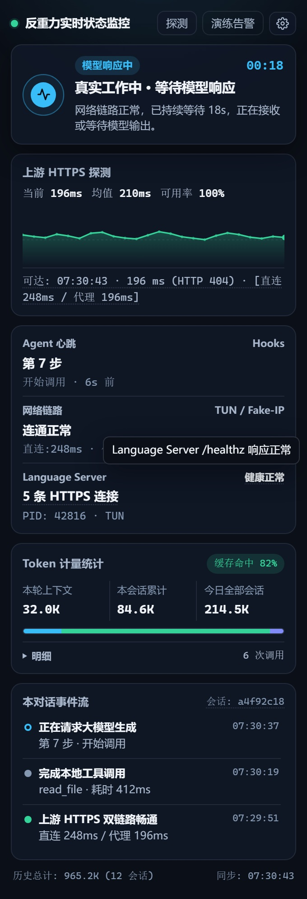
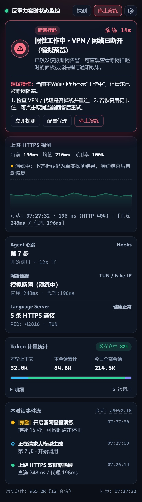
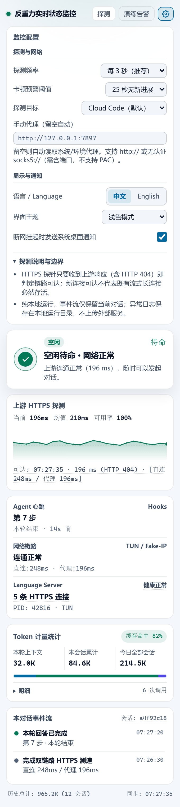

**简体中文** | [English](README.en.md)

# 反重力实时状态监控 (`antigravity-status-monitor`)

用 Antigravity 跑长任务时，主界面常常一直转着 **"Working"** 却迟迟没有输出——有时只是模型在深度思考或执行工具，但很多时候其实是 **VPN 掉线**、TUN 虚拟网卡异常或代理失效，请求早已卡死，界面却仍停留在“假性工作中”。

**反重力实时状态监控**是一个**纯本地、零第三方依赖**的右侧边栏监控面板。它实时汇总 Agent 执行阶段、宿主 `Language Server` 状态、直连/代理双链路 HTTPS 探针与 Token 消耗，让你扫一眼就能分辨「正常推进」与「静默挂起」，并在断网时给出桌面通知与就地排查入口。

- **一眼定状态**：区分模型思考、工具执行、后台任务待唤醒、接口报错重试与断网挂起，减少误中断与盲等。
- **窄栏原生体验**：适配右侧窄边栏与宽屏双栏布局，支持深浅主题自动跟随、中英双语、15 秒告警演练与即时悬停解释。
- **纯本地零外发**：仅监听 `127.0.0.1`，默认全接口令牌鉴权与严格离线 CSP；网络探测仅发极轻量连通请求，不携带账号或对话数据。

---

## 界面预览

| 实时工作态与悬停解释 | 断网演练与就地排查 | 浅色配置与探测说明 |
| :---: | :---: | :---: |
|  |  |  |

> 点击任意预览图可查看原图：左图为深色工作态与页面内悬停解释浮层，中图为 15 秒断网演练及卡片内联操作，右图为浅色主题设置与展开后的「探测说明与边界」。

---

## 工作原理

单看主界面的加载动画很难判断卡在哪一步，插件把四路直接信号拼在一起判断：

1. **Lifecycle Hooks + Transcript 阶段推断、后台任务与 API 重试识别**
   - [hooks.json](hooks.json) 只挂载 `PreInvocation` 与 `Stop` 两个关键事件（默认优先调用内置 `agy-node`，没装全局 Node 也能跑）；
   - **后台任务待唤醒（`BACKGROUND_TASK`）**：当本轮对话暂告结束但仍有后台命令/子代理未完成时，识别 `Stop` Hook 的 `fullyIdle: false`（以及 `transcript.jsonl` 未闭合后台任务兜底），展示「后台任务运行中 · 等待回调唤醒」，既不再误显示 `空闲`，也不触发 `25s` 卡顿告警，待后台结束后自动随二次唤醒回归正常流程；
   - **并行多工具进度与异常中止识别**：当单轮并发调用多个工具（如多个 `read_file` + `run_command`）且仅有部分快速工具回写结果时，仍保持 `工具执行中`；若 `PLANNER_RESPONSE` 带 `tool_calls` 却以 `CANCELLED`/`ERROR` 异常中止，则直接回到 `空闲`；
   - 只要 `transcript.jsonl` 有新输出或有新 Hook 进来，等待计时就会立刻归零；同时实时解析 `ERROR_MESSAGE`（`wsasend` 上传重置、`EOF`、`stream idle timeout`、`model unreachable`，3 分钟独立过期）及常见中间步骤，在轻探针仍绿灯但接口报错重试时直接标出 `接口重试` 并同步到本对话事件流。
2. **双链路 HTTPS 短连接探针（直连/TUN vs 代理）与分层防抖**
   - 按设定周期分别走直连和代理测一次短连接可达性（默认探测 `https://daily-cloudcode-pa.googleapis.com`，默认单次超时 `4000ms`），支持自动读取环境变量/系统代理与手动 HTTP `Basic` / 无认证 SOCKS5 代理，再结合宿主 `Language Server` 的 443 端口连接状态一起判断链路；
   - **分层防抖 + 混合路由纠偏 + 休眠保护**：硬断连（`ENOTFOUND`/`ECONNREFUSED`/HTTP 阻断）连续 2 次触发 `DISCONNECTED_HANG`，而纯慢超时（如 `2.5s~4s` 边缘波动）第 2 次先进入 `NET_SUSPECT` 复测、连续 3 次才升为断网挂起；若 `LS` 存在活跃代理连接且代理探针通畅而直连不通，优先采信代理链路（避免因零星直连或 `100.64.0.0/10` 运营商 CGNAT 误判成直连/TUN）；系统休眠唤醒产生的时间跳变会自动清零历史失败计数；
   - **自适应短连接轮询 + 严格本对话隔离**：面板前台每 1 秒通过 `/api/status` 拉取状态（`~2ms` 用完即释放连接，切到后台自动暂停并释放连接槽位，彻底避免多个 Sidecar 标签长期占满 Chromium 6 条 HTTP/1.1 连接上限导致新面板转圈或按钮无响应）。前端无任何对话切换选项，服务端也彻底移除 `auto` 切换与跨目录抢占逻辑，每个对话均使用物理分桶的实时事件流，仅展示本对话的 Hooks、工具步骤、演练预警与网络变更，随宿主切换对话时同步切换；服务端仍保留 `/api/events` SSE 接口供外部按需订阅。
3. **宿主进程追踪、分因告警防抖与自动退出**
   - 优先按 `ANTIGRAVITY_LS_ADDRESS` 定位当前对应的宿主 `Language Server` 进程；进程退出立刻告警，进程存活时的 `/healthz` 检测（单次超时 `3000ms`）与高负载下带健康连接的孤立 `SYN_SENT` 均需连续 2 轮确认后才告警；若 Antigravity 关掉且 `/healthz` 连续 3 次不可达，Sidecar 会自动退出；
   - **多会话告警评估 + 有界故障日志**：探测周期遍历当前钉选/首选活跃会话以防漏报后台对话挂起，严格区分 **VPN / 上游网络断开** 与 **Language Server 失联** 两类桌面通知文案，并将包含 `convId` 与 `message` 的完整故障/恢复记录持久化到 `.runtime/alerts.log`（有界 JSONL，自动裁剪）供事后排查。
4. **默认全接口认证 + DNS 重绑定防护 + 严格 CSP 锁定**
   - 仅监听 `127.0.0.1`，并在 HTTP 入口校验 `Host` 头仅允许回环地址（`127.0.0.1` / `localhost` / `[::1]`），直接拦截 DNS 重绑定探测；
   - **所有 `GET /api/*` 与 `POST /api/*` 默认强制鉴权**：即使脱离宿主独立运行（未设置 `ANTIGRAVITY_SIDECAR_UI_TOKEN`），启动时也会自动生成随机 48 位 hex `uiToken`（并在控制台输出带 `?token=...` 的本机访问链接）；同时校验 `Sec-Fetch-Site`（拦截 `cross-site`）与 `Origin`（拦截 `Origin: null` 与外部域），`POST` 额外强制 `Content-Type: application/json`，Hook 上报使用独立的随机 `X-Hook-Token`（`.runtime/server.json` 不写入 `uiToken`）；
   - **Dashboard 响应头锁定严格 CSP**：全部静态页面与 API 响应下发 `Content-Security-Policy: default-src 'self'; connect-src 'self'`（且前端无任何内联样式/脚本），从浏览器层面物理阻断面板向任何外部域名外发数据或加载外部资源。

---

## 已知局限与边界

这只是一个轻量的 Sidecar 状态面板，并非内核级抓包工具，以下边界需要注意：

* **新建短探针能通 ≠ 旧的长连接还活着**：网络探针是周期性新建 HTTPS GET 短连接测试域名 / TLS / HTTP 是否通畅（`2xx/3xx` 及 `400/404/405/410` 视为上游有响应，因为 `daily-cloudcode-pa.googleapis.com` 根路径默认返回 `404`；`401/403/407/408/429/451` 与 `5xx` 均判定为阻塞或失败）。如果只是代理节点波动导致**原本那条流式长连接或大包上传（`wsasend`）被远端重置**，在 Antigravity 写入 `ERROR_MESSAGE` 重试日志后，面板会立即标出 `接口重试`；若请求仍完全静默阻塞且尚未落盘报错、而新建探针刚好成功，则会倾向显示“网络正常 / 疑似模型卡顿”。
* **代理与 TUN 识别覆盖范围**：支持环境变量（`HTTPS_PROXY` / `HTTP_PROXY` / `ALL_PROXY` / `NO_PROXY`）、Windows 注册表 `HKCU`/`HKLM`（含 `ProxyOverride` 绕过列表与 `DefaultConnectionSettings` 开关校验）、macOS `scutil`（含 `ExceptionsList`）、Linux GNOME `gsettings`（含 `ignore-hosts`）中的 **HTTP 代理**（含基础 `Basic` 鉴权）与**无认证 SOCKS5 代理**，并支持设置面板里的**「手动代理」**兜底（适合 PAC、非 GNOME 桌面、纯 SOCKS5 等场景）；**暂不支持解析 PAC 脚本（会给提示）、`https://`/`socks4://` 代理、带密码的 SOCKS5、企业 NTLM 域认证或按进程注入式透明分流工具；公司网关若使用了未导入 Node 信任链的中间人自签根证书，也可能报 TLS 失败**。TUN 网卡基于 `198.18.0.0/15`（Fake-IP）与 `100.64.0.0/10`（CGNAT / Tailscale / WireGuard 等常见段）做启发式归类；若同时存在活跃代理连接且仅代理探针通畅，插件会自动纠偏优先采用代理探测结果（避免因运营商宽带也使用 `100.64.0.0/10` 而误判）。
* **超时阈值与高思考强度模型**：默认单次网络探测超时为 `4000ms`（纯超时需连续 `3` 次才触发断网挂起，硬错误连续 `2` 次触发）；Antigravity 通常在整轮思考/回复生成完毕后才落盘 `PLANNER_RESPONSE`，因此使用高思考强度模型单轮耗时超过 `25s` 属正常现象，可在设置中将卡顿预警阈值调至 `45s`。
* **Hooks 与常驻开销**：Antigravity 每次 `PreInvocation` / `Stop` 时会拉起一次短暂的轻量 Hook 进程；Sidecar 本身为常驻本地 Node 进程。
* **本地接口访问范围**：即使仅绑定 `127.0.0.1`，全部 `GET /api/*`（含 `/api/status`、`/api/events`）与 `POST /api/*` 均默认强制校验 `X-Sidecar-Token`（或 SSE 使用的 `?token=`）、`Host` 回环白名单、`Sec-Fetch-Site` 与 `Origin`；未授权网页或未携带 Token 的本机请求会被直接拦截（`401`/`403`）。
* **Token 统计口径**：`total` 直接累加 `input_tokens + cache_read_tokens + output_tokens` 的原始次数，用来直观感受工作量与缓存命中趋势即可，不能直接等同于官方计费或配额扣减；当前会话优先走 Hook 上报路径，全量历史统计扫描 `transcript.jsonl`（不存在时回退 `transcript_full.jsonl`）。
* **本地告警日志与弹窗控制**：Sidecar 仅在本地 `.runtime/alerts.log` 保留有界裁剪后的关键告警/恢复摘要 JSONL（默认上限 `64 KB` / 最近 `120` 条），不上传任何外部服务；指定 `ANTIGRAVITY_APP_DATA_DIR` 时会严格隔离 `brain/` 扫描范围，无头测试或自动化脚本可通过 `ASM_DISABLE_NOTIFICATIONS=1` 静默系统桌面弹窗。

---

## 跨平台支持矩阵

| 平台 | HTTPS 可达性探针 | 系统代理探测 | Language Server & 443 套接字检测 | 系统桌面通知 | 验证程度 |
| :--- | :--- | :--- | :--- | :--- | :--- |
| **Windows** | 支持 | 环境变量 + 注册表 `HKCU`/`HKLM`（HTTP / SOCKS5 / `ProxyOverride`；PAC 提示不支持，可手动指定代理） | `netstat -ano -p TCP` + `tasklist` + CIM | PowerShell WinRT Toast 通知 | **实机长运行验证** + CI 集成测试 |
| **macOS** | 支持 | 环境变量 + `scutil --proxy`（HTTP / SOCKS5；PAC 提示不支持，可手动指定代理） | `lsof -nP -iTCP` + `pgrep`/`ps` | `osascript` 系统通知 | 单元测试 + GitHub Actions macOS CI |
| **Linux** | 支持 | 环境变量（含 `ALL_PROXY`/`NO_PROXY`）+ GNOME `gsettings`（HTTP/SOCKS/PAC；非 GNOME 可用环境变量或手动代理） | `ss -tnap`（回退 `lsof`）+ `pgrep`/`ps` | `notify-send` | 单元测试 + GitHub Actions Ubuntu CI |

---

## 快速安装与卸载

### 方式一：让反重力 (Antigravity) 帮你自动下载并安装（推荐，零 Git / 零命令行）

不会用 Git 或命令行也没关系。新建一个 Antigravity 对话，直接复制下面这段话发给它，反重力会自动完成下载、校验、解压与安装（已有 `.runtime/config.json` 配置也会原样保留）：

```text
请帮我下载并安装（或更新）反重力状态监控插件 Antigravity Status Monitor：
1. 从 https://github.com/rimenine/antigravity-status-monitor/releases/latest 下载适合我当前系统的安装包（Windows 用 agent-status-monitor.zip，macOS / Linux 用 agent-status-monitor.tar.gz），如有 SHA256SUMS.txt 请先校验文件完整性；若暂无预打包 Release，则改用主分支源码包。
2. 解压到临时目录后，运行其中的 install.ps1（Windows）或 install.sh（macOS / Linux）完成安装，脚本会自动保留我原有的 .runtime/config.json。
3. 安装完成后清理临时目录，并验证插件文件与面板入口是否就绪。
```

> 升级插件同样适用：把同一段话再发给 Antigravity 一次，它会自动停止旧版 Sidecar、替换运行文件并保留你的预警阈值与通知配置。

### 方式二：手动下载 Releases 压缩包或命令行安装

前后端无任何第三方依赖，可直接下载 [Releases](https://github.com/rimenine/antigravity-status-monitor/releases/latest) 中的预打包压缩包（附 `SHA256SUMS.txt`），解压到任意目录运行安装脚本（或直接将包内 `agent-status-monitor/` 目录解压放进 `~/.gemini/config/plugins/`），也可以直接执行一行安装命令：

```powershell
# Windows (PowerShell 一键拉取最新安装包并安装)
$tmp = Join-Path $env:TEMP "asm-install"; Remove-Item $tmp -Recurse -Force -ErrorAction SilentlyContinue; New-Item -ItemType Directory -Force $tmp | Out-Null
Invoke-WebRequest "https://github.com/rimenine/antigravity-status-monitor/releases/latest/download/agent-status-monitor.zip" -OutFile "$tmp\asm.zip"
Expand-Archive "$tmp\asm.zip" -DestinationPath $tmp -Force
powershell -ExecutionPolicy Bypass -File "$tmp\agent-status-monitor\install.ps1"
```

```bash
# macOS / Linux (一键拉取最新安装包并安装)
TMP_DIR="$(mktemp -d)" && curl -fsSL "https://github.com/rimenine/antigravity-status-monitor/releases/latest/download/agent-status-monitor.tar.gz" | tar -xz -C "$TMP_DIR" && sh "$TMP_DIR/agent-status-monitor/install.sh" && rm -rf "$TMP_DIR"
```

### 方式三：Git 源码克隆安装与卸载

```powershell
# Windows (PowerShell)
git clone https://github.com/rimenine/antigravity-status-monitor.git
cd antigravity-status-monitor
powershell -ExecutionPolicy Bypass -File .\install.ps1
```

```bash
# macOS / Linux
git clone https://github.com/rimenine/antigravity-status-monitor.git
cd antigravity-status-monitor
sh ./install.sh
```

也可以直接将仓库克隆到 `~/.gemini/config/plugins/agent-status-monitor`。`install.ps1` / `install.sh` 脚本会自动检测 `~/.gemini/config` 和 `agy-node` / `node`，只拷贝运行必需文件（跳过 `tests/`、`docs/`、`.github/`、`.git/`、`scripts/` 与 `README.en.md`），已有的 `.runtime/config.json` 配置也会原样保留。

卸载（脚本会自动先清理配置并停止运行中的 Sidecar；如果 Antigravity 正开着，建议先停用插件或关闭 IDE 再卸载，避免宿主保活拉起；也可以直接让 Antigravity 运行插件目录中的 `uninstall.ps1` / `uninstall.sh`）：

```powershell
# Windows (PowerShell)
powershell -ExecutionPolicy Bypass -File .\uninstall.ps1              # 完全卸载
powershell -ExecutionPolicy Bypass -File .\uninstall.ps1 -KeepConfig  # 卸载但保留配置文件
```

```bash
# macOS / Linux
sh ./uninstall.sh                # 完全卸载
sh ./uninstall.sh --keep-config  # 卸载但保留配置文件
```

安装后打开或重启 Antigravity（若为覆盖更新，建议在插件管理中关闭再重新开启一次，或重启 IDE），在对话中发送 **`打开反重力状态监控面板`** 即可唤出右侧面板。

---

## 功能与配置说明

- **顶部按钮**：`探测`（立即测速）、`演练告警` / `停止演练`（15 秒模拟断网挂起效果）、**齿轮图标**（在顶栏下方展开/收起配置，支持 `Esc` 快捷关闭并还原焦点）。
- **告警内操作 & 悬停提示**：断网告警内附**立即探测**、**配置代理**与**停止演练**就地出口；带有细虚线下划线的项目（如 `(HTTP 404)` 可达解释、`健康正常`、HTTPS 连接数、折线采样点与缩写会话 ID）悬停即弹出高对比度解释卡片。
- **可调参数**：界面语言（`中文` / `English`，首次按系统语言自动选择）、探测频率（`2s` / `3s` / `5s`）、卡顿预警阈值（`15s` / `25s` / `45s`）、探测目标、手动代理、主题模式（跟随宿主 / 系统、深色模式、浅色模式）、断网系统通知开关，底部附可折叠「探测说明与边界」。
- **Token 卡片**：默认展示本轮上下文、本会话累计、今日全部会话、缓存命中率与比例进度条，点击「明细」可展开/收起输入、缓存读取与输出构成及统计口径。

---

## 目录结构

```text
antigravity-status-monitor/
├── package.json                    # 插件元数据与测试入口（npm test）
├── plugin.json                     # Antigravity 插件清单
├── .github/workflows/
│   ├── ci.yml                      # GitHub Actions 三平台自动化 CI
│   └── release.yml                 # Tag / 手动一键打包 GitHub Release 流水线
├── scripts/
│   └── package-release.mjs         # 零依赖打包 .zip / .tar.gz 与 SHA256SUMS.txt
├── hooks.json                      # 生命周期 Hooks（PreInvocation + Stop）
├── install.ps1 / uninstall.ps1     # Windows 一键检测安装 / 卸载脚本
├── install.sh / uninstall.sh       # macOS / Linux 一键检测安装 / 卸载脚本
├── LICENSE                         # MIT 开源协议
├── README.md                       # 中文说明文档
├── README.en.md                    # 英文说明文档（English README）
├── assets/logo.svg                 # 插件图标
├── docs/screenshots/               # README 界面预览截图
├── hooks/hook-reporter.mjs         # Hook 事件上报脚本（X-Hook-Token 鉴权）
├── skills/status-monitor/SKILL.md  # 状态监控与排查引导 Skill
├── tests/                          # 单元测试与真实系统命令集成测试（node:test）
└── sidecars/status-monitor/
    ├── sidecar.json                # Sidecar 注册配置
    ├── server.mjs                  # Sidecar 入口、路由分发与生命周期组合
    ├── lib/
    │   ├── config.mjs              # 运行时路径、brain 隔离与配置持久化
    │   ├── alert-logger.mjs        # 有界 JSONL 故障告警与恢复持久化日志
    │   ├── runtime-paths.mjs       # 多窗口 .runtime/servers 与 hooks 作用域工具
    │   ├── http-helpers.mjs        # 安全响应头、静态白名单与 JSON 收发
    │   ├── sse-hub.mjs             # SSE 广播 hub 与多标签页钉选会话跟踪
    │   ├── server-registry.mjs     # 多实例注册表与退出清理
    │   ├── probe-coordinator.mjs   # 探针调度、LS 探查、分因告警去重与落盘
    │   ├── i18n.mjs                # 中英文双语文案、分因通知与事件翻译
    │   ├── security.mjs            # CSRF 防护、Content-Type 与双令牌鉴权
    │   ├── sdk-bridge.mjs          # sidecar_sdk 桥接（/preload.js 与 AgentAPI）
    │   ├── transcript-phase.mjs    # 步骤阶段推断、并行工具/后台任务及错误分类纯函数
    │   ├── transcript-reader.mjs   # Transcript 尾部读取、时钟窗校验与快照解析
    │   ├── fallback-hooks.mjs      # 离线 Hook 降级文件加载与作用域清理
    │   ├── timeline-store.mjs      # 按会话物理分桶的时间线事件仓库
    │   ├── state-store.mjs         # 严格单对话状态锁定与快照汇总
    │   ├── verdict.mjs             # 纯函数状态诊断引擎
    │   ├── proxy-bypass.mjs        # IP/CIDR/通配符/NO_PROXY 绕过匹配与 IP 标准化
    │   ├── proxy-url.mjs           # 代理 URL 校验/解析与环境变量代理读取
    │   ├── proxy-system.mjs        # Windows 注册表 / macOS scutil / Linux gsettings 代理检测
    │   ├── proxy.mjs               # 代理检测缓存协调与统一导出门面
    │   ├── proxy-tunnel.mjs        # HTTP CONNECT 与无认证 SOCKS5 隧道握手
    │   ├── process-probe.mjs       # Language Server 进程、端口与路由探查
    │   ├── notify.mjs              # 跨平台桌面系统通知（WinRT / AppleScript / libnotify）
    │   ├── probe.mjs               # 直连与代理隧道 HTTPS 上游探测（统一导出门面）
    │   └── tokens.mjs              # Token 计量解析与缓存聚合
    └── public/
        ├── index.html
        ├── styles.css
        ├── app.js                  # 面板入口装配、事件绑定、焦点还原与悬停浮层
        └── js/
            ├── i18n.js             # 前端双语词典与静态文本翻译
            ├── format.js           # 时间/Token 格式化与主题自适应
            ├── render.js           # 延迟曲线 SVG、时间线与各状态卡片渲染
            └── client.js           # 鉴权请求、自适应短轮询与错条管理
```

---

## 运行自动化测试

零第三方依赖，可直接使用系统 Node 或 Antigravity 内置 `agy-node` 运行：

```bash
npm test
# 或使用 Antigravity 内置运行时：
agy-node --test tests/*.test.mjs
```

---

## License

[MIT](LICENSE) © 2026 [rimenine](https://github.com/rimenine)
